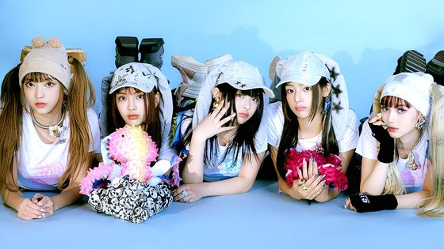
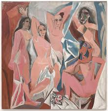
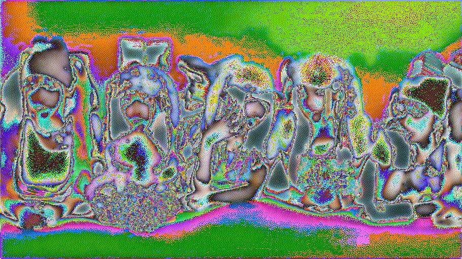

# StyleCraft

Course project for a CUDA Advanced Libraries course (Euisuh Jeong; commits are from April 2024). Neural style transfer in PyTorch: it optimizes a copy of the content image so its VGG-19 feature statistics (Gram matrices) match a style image.

| Content | Style | Result |
|----------|-------|--------|
|  |  |  |

## What it shows

- `main.py`: pretrained VGG-19 features (max-pooling replaced by average pooling), content loss on `conv4_1`, weighted style loss on `conv1_1`..`conv5_1`, 300 Adam steps (lr 0.003). Uses CUDA if available, otherwise CPU.
- `utils.py`: image loading, tensor-to-image conversion, saving.
- The sample result above is a single run; no quantitative evaluation or GPU timing is included.

## How to run

```
pip install -r requirements.txt
python main.py <content_image> <style_image> <output_image>
python main.py assets/newjeans-omg.jpeg assets/les-demoiselles-davignon.jpeg out.jpeg
```

The first run downloads the VGG-19 weights through torchvision. I did not re-run the script when tidying this repo.
